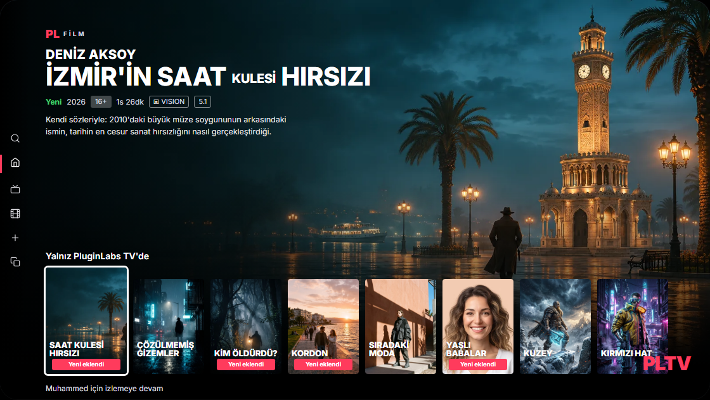
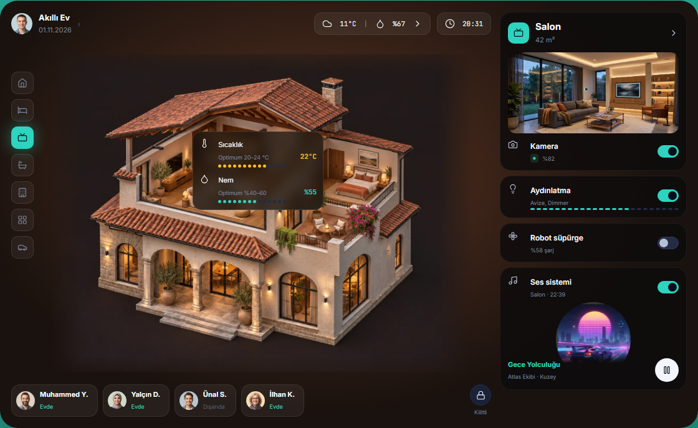
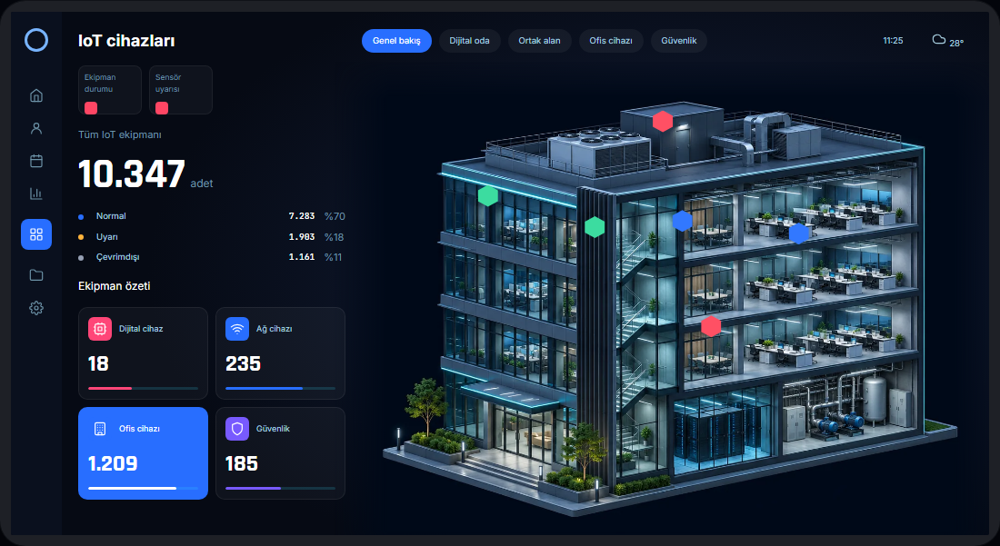
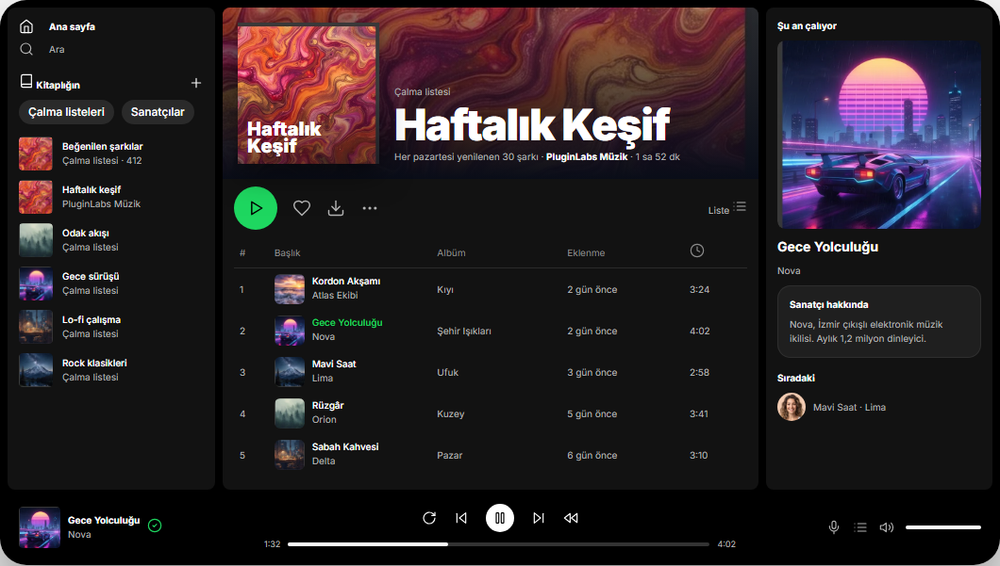

# PluginLabs Advanced Tasarım Sistemi

Claude Code ve Codex'in **ortak** kullandığı PluginLabs Advanced tasarım sistemi skill'i. Temel PluginLabs katmanını (79 komponent) ve masaüstü uygulama katmanını (102 komponent, 12 ekran şablonu, 6 yüzey teması) tek pakette toplar. v2.1.0 ile 9 ek temel bileşen geldi (PLC-080…088); mevcut 181 bileşen değişmedi.

| Klasör | Ne |
|---|---|
| `pluginlabs-advanced/` | Kanonik skill (Agent Skills standardı: `SKILL.md` + references + assets + build) |
| `claude-design/` | Claude Design tasarım sistemi projesi (tokens, 181 komponent önizlemesi, kapak); `/design-sync` ile yüklenir |
| `kurulum/` | `kur.sh` / `kur.ps1` (tek repo), `kisisel-kur.*` (tüm projeler), `repolara-kur.ps1` (tüm PluginLabs repoları), `AGENTS.md` / `CLAUDE.md` parçaları |

## Hızlı kurulum
```bash
bash kurulum/kur.sh /yol/PluginLabs                # kopya
KIP=symlink bash kurulum/kur.sh /yol/PluginLabs    # tek kaynak (sembolik bağ)
```
```powershell
powershell -ExecutionPolicy Bypass -File kurulum\kur.ps1 -Repo C:\Projeler\PluginLabs
```
Sonra `kurulum/AGENTS.md.parca` → repo kökündeki `AGENTS.md`'ye, `kurulum/CLAUDE.md.parca` → `CLAUDE.md`'ye eklenir.
Kurulum mevcut sürümleri **silmez**, `design-system/_arsiv/GG.AA.YYYY/` altına taşır. Temel `pluginlabs-design` skill'i bulunursa o da arşive alınır (Advanced onu kapsar; ajanlar iki skill görmez).

## Varsayılan yap (tüm projeler, tek komut)
```powershell
powershell -ExecutionPolicy Bypass -File kurulum\kisisel-kur.ps1
```
```bash
bash kurulum/kisisel-kur.sh
```
Skill'i `~/.claude/skills/pluginlabs-advanced/` altına kurar ve `~/.claude/CLAUDE.md` dosyasına "varsayılan tasarım sistemi" kuralını ekler. Eski sürümler `~/.claude/_arsiv/GG.AA.YYYY/` altına taşınır.

## Tüm PluginLabs repolarında varsayılan yap
```powershell
powershell -ExecutionPolicy Bypass -File kurulum\repolara-kur.ps1 -Kok C:\Users\pc\github
```
`-Kok` altındaki, PluginLabs'tan söz eden her git reposunda `CLAUDE.md` / `AGENTS.md` sonuna varsayılan tasarım sistemi bölümünü ekler; `design-system/pluginlabs-design` bulunan repolara skill'i de kurar. Önceki md dosyaları `_arsiv/GG.AA.YYYY/` altında yedeklenir; bölüm zaten varsa dokunmaz.

## Claude Design
`claude-design/` klasöründe terminal açıp `claude` → `/design-sync` yazılır; sistem Claude Design'da "PluginLabs Advanced" adıyla görünür.

## Kişisel (tüm projeler) kurulum
- Claude Code: `~/.claude/skills/pluginlabs-advanced/`
- Codex: `~/.agents/skills/pluginlabs-advanced/`

## Önizleme
`pluginlabs-advanced/assets/pl-galeri.html` dosyasını tarayıcıda aç: tema, katman (Temel/Advanced), yüzey teması ve ürün aksanı canlı değiştirilebilir; her kartta kopyalanabilir HTML bulunur.

`pluginlabs-advanced/assets/pl-pin-ekranlari.html` dosyası Pinterest panosundaki ekranların 33 ayrıntılı HTML karşılığını gösterir; iki sayfa birbirine bağlantılıdır.

### Canlı (GitHub Pages)
- [Komponent galerisi](https://timdesigners-pixel.github.io/pluginlabs-advanced/pluginlabs-advanced/assets/pl-galeri.html)
- [Pin ekranları](https://timdesigners-pixel.github.io/pluginlabs-advanced/pluginlabs-advanced/assets/pl-pin-ekranlari.html) (yer tutuculu, kanonik)
- [Pin ekranları · görselli vitrin](https://timdesigners-pixel.github.io/pluginlabs-advanced/vitrin/): aynı ekranlar, yer tutucuların yerinde gerçek görsellerle

`vitrin/` skill paketinin parçası değildir; kurulum betikleri onu kopyalamaz. Görseller `vitrin/img/` altında (WebP, en fazla 1600 px). Kanonik sayfa yeniden üretildiğinde vitrini de güncelle: `python -I vitrin/build_vitrin.py`. Görsel–ekran eşlemesi betikteki `ESLEME` sözlüğündedir.

### Vitrin görsel güncellemesi · 04.11.2026

TV ana filmi, akıllı villa, IoT bina sahnesi, Valoris taktik nişancı kampanyası ve uzay kategorisi için beş özgün görsel üretildi. Dört mevcut müzik kapağı tamamlandı; liste, kitaplık ve oynatıcı kapakları eşleştirildi. Karakter stüdyosunun referansı sonuç karakteriyle eşleşir. Drone kamera görüntüsünü kapatan eski maket kaldırıldı; histogram, telemetri ve IoT'nin altı durum işaretçisi korunur.

**Gerçek tarayıcı ekran görüntüleri:** Windows, headless Chromium, 1440×1100; ayrıca 820×1100 dar görünüm kontrol edildi. Bunlar çalışan vitrinin statik arayüz örnekleridir; gerçek cihaz bağlantısı veya masaüstü uygulama derlemesi kanıtı değildir.






[Önce/sonra ve doğrulama kaydı](vitrin/REVIEW.md) · [Görsel kaynakları ve üretim istemleri](vitrin/IMAGE-SOURCES.md)

Doğrulama: mevcut bir Playwright kurulumu ile `node vitrin/verify_vitrin.cjs`. Modül başka projede kuruluysa `PL_PLAYWRIGHT_MODULE` ortam değişkenine o modülün yolunu ver. Betik paket indirmez; yalnız loopback HTTP sunucusu ve görünmeyen tarayıcı açar.

## Güncelleme
`pluginlabs-advanced/build/components.py` (temel) veya `build/advanced*.py` (advanced) düzenle → `python3 pluginlabs-advanced/build/build.py` → `kur.sh` ile eşitle.
