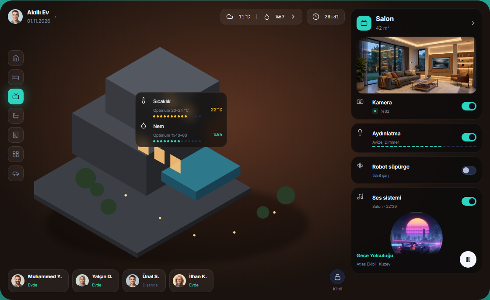
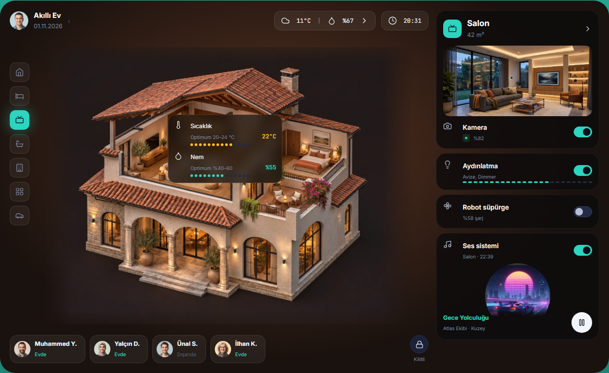
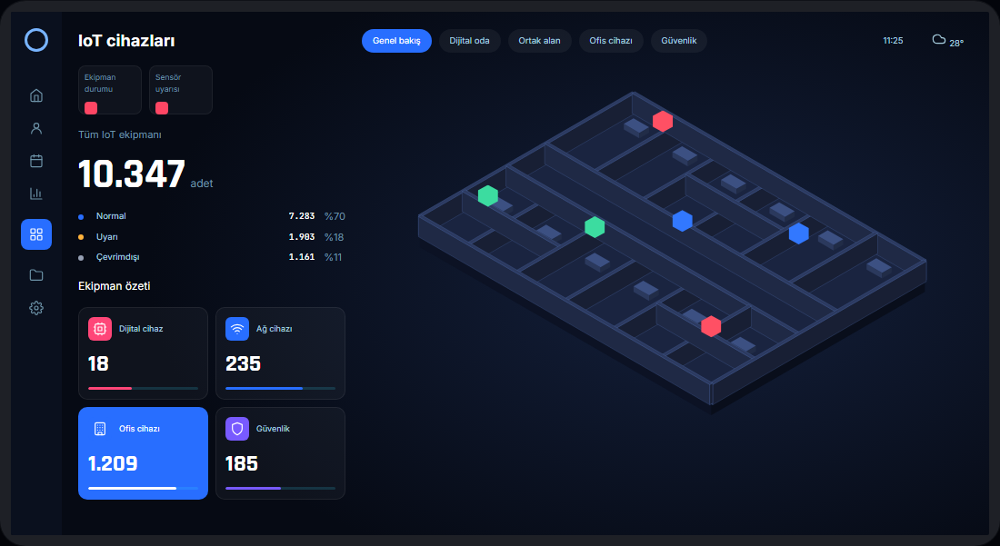
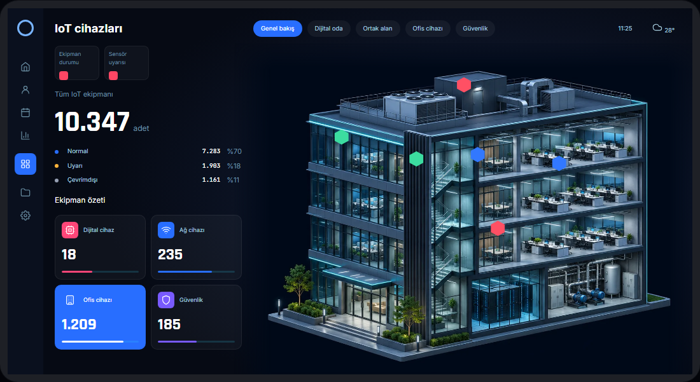
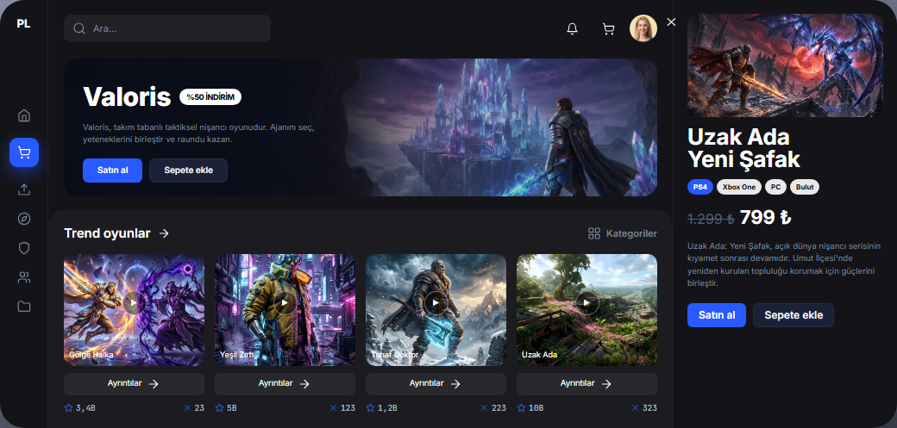
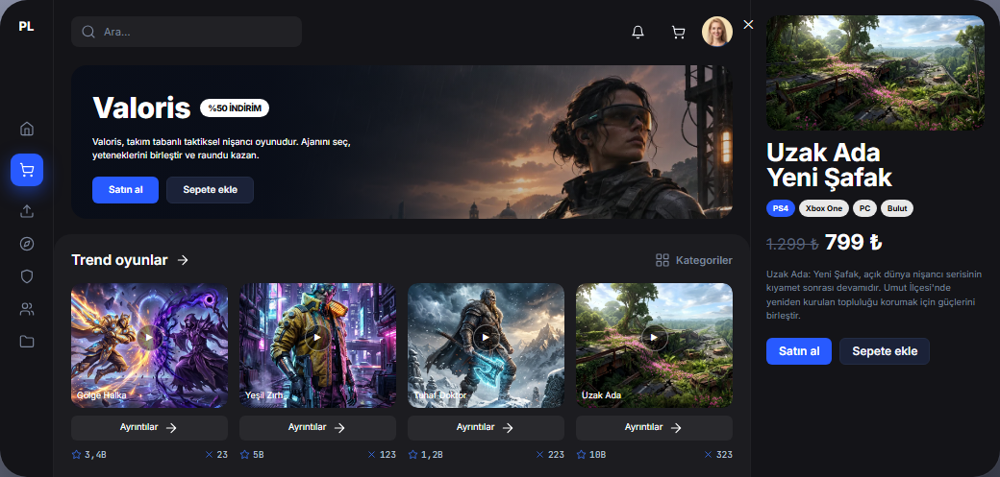
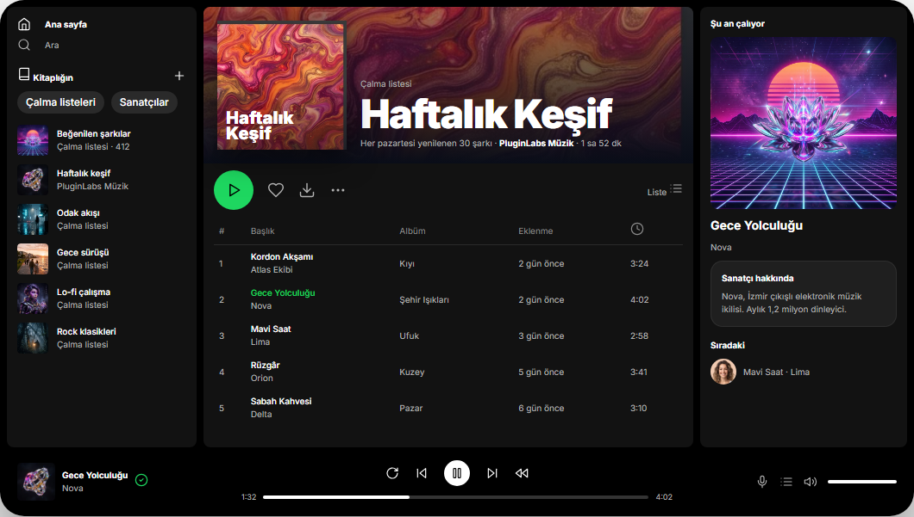
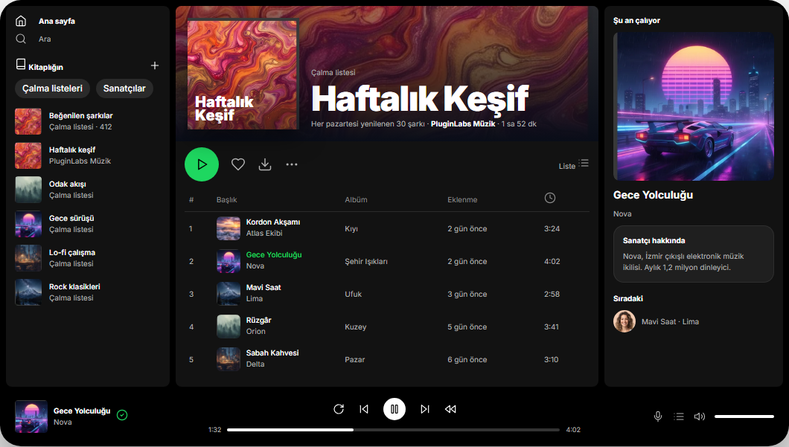

# Vitrin görselleri · inceleme ve devir

Tarih: 04.11.2026. Sahip: bu Codex sohbeti. Dal: `codex/advanced-vitrin-images`.

Kaynak: kullanıcının PluginLabs Advanced vitrini ve eksik görselleri tamamlama talimatı. Ayrı GitHub issue veya Notion görev URL'si sağlanmadı.

## Değişen davranış

| Ekran | Sonuç |
|---|---|
| Pin 02 | Saat Kulesi filmi için sinematik ana sahne; posterler konuya göre eşleşir |
| Pin 06 | İzometrik villa; sıcaklık/nem kartı ve oda kontrolleri korunur |
| Pin 07 | Valoris metniyle uyumlu taktik nişancı görseli; açık dünya kartına orman sahnesi |
| Pin 08 | Detaylı IoT bina sahnesi; altı HTML durum işaretçisi ve sayaçlar korunur |
| Pin 14 | Referans ve sonuç aynı gözlüklü gezgin karakterini gösterir |
| Pin 18 | Kamerayı kapatan eski uçurum maketi kaldırılır; HUD/histogram yerinde kalır |
| Pin 45 | Dört kategoriye konuya uygun arka plan; mevcut 3B simgeler korunur |
| Pin 100 | Beş satıra kapak; Gece Yolculuğu kapağı kitaplık, ana oynatıcı ve alt çubukta tutarlı |

Beş yeni görsel toplam 607.228 bayt; WebP, uzun kenar en fazla 1600 px. Dört küçük müzik kapağı önceki tamamlanmamış çalışmadan korunmuştur. Yeniden üretilmemiştir.

Yeni sahneler opt-in `[data-pl]` içinde `pl-vitrin-*` sınıflarıyla ve `@layer pl` katmanında yer alır. Mevcut tokenlar ve yüzeyler korunur (medya, akıllı ev, HUD, MyMind ve kokpit; ilgili PLA-011/017/034/066/077 desenleri). Yeni komponent veya rakip palet eklenmez. Kanonik skill dosyaları değişmez.

## Kanıt

Windows + headless Chromium 156.0.8078.4; 1440×1100 ve 820×1100. Ayrı kullanıcı tarayıcısı/foreground masaüstü kullanılmadı.

- 33 ekran, 70 yerel görsel referansı: erişilebilir.
- Sayfa JavaScript hatası ve yerel HTTP hatası: yok.
- Kanonik kopyalanabilir HTML blokları: birebir aynı.
- IoT: 6 durum işaretçisi; drone: HUD ve histogram korunur.
- Eklenen sahnelerin alt metinleri, `loading="lazy"`, `decoding="async"` ve gerçek boyutları vardır. Satır kapakları bitişik parça adıyla tekrar etmemek için dekoratiftir (`alt=""`).
- Yeni görsellerin kırpımı ve masaüstü/dar görünüm ekran görüntüleri gözle incelenmiştir.
- Electron/Windows kurulum, DPI, gerçek cihaz, canlı AI bağlantısı ve tam erişilebilirlik denetimi bu statik vitrin çalışmasında çalıştırılmadı.

[Makine okunur doğrulama](evidence/after/verification.json)

Önce görüntüleri, `e9573cb` tabanındaki vitrinden alındı. Sonra görüntüleri bu dalın çalışma ağacından alındı; teslim paketindeki BUILD-INFO kesin kaynak commit'ini ve dosya hash'lerini kaydeder.

| Önce | Sonra |
|---|---|
|  |  |
|  |  |
|  |  |
|  |  |

## Devir ve geri dönüş

İlk checkout'ta kaynak klasörün tamamı yerelde silinmiş görünüyordu; ayrıca başka tamamlanmamış değişiklikler vardı. O çalışma ağacı değiştirilmedi. HEAD'den ayrı checkout oluşturuldu; yalnız vitrin üreticisi ve dört müzik kapağı taşındı.

Kullanıcı 04.11.2026 tarihinde yeni haliyle release ve Pages yayınına açık onay verdi. v2.1.4 sürümü bu talimatla hazırlanır. Önceki tam sürüm `_arsiv/04.11.2026/e9573cb/` altında ve release arşiv ZIP dosyasında korunur. Geri dönüş: yalnız bu PR commit'ini geri alıp `python -I vitrin/build_vitrin.py` ile önceki vitrini üret. Kanonik şablonlar ve önceki görseller korunmuştur.

Kullanıcı yayın onayı verdi; bağımsız ikinci ajan incelemesi yapılmadı. Önizleme çıktısı statik site ZIP'idir; uygulama exe'si değildir. ZIP ile ekran görüntüleri, SHA256 ve BUILD-INFO birlikte teslim edilir.
